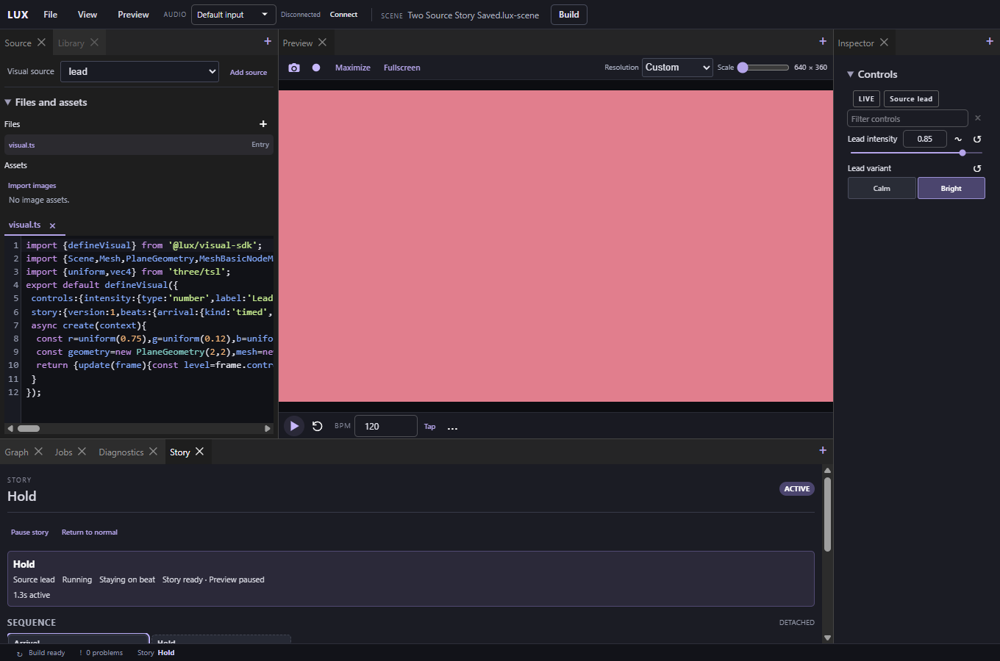

# Multi-visual Story implementation evidence

LUX-198, branch `codex/story-controls`, worktree `.worktrees/story-controls`.
The implementation contract is in `story-lifecycle-review.md`; shared executable
packaging follows `story-shared-linker-amendment.md`.

Scene 7 stores up to eight SDK 0.2 sources with individual control snapshots and
animations. Story 2 routes manual beats and sequence occurrences to those sources.
Studio prepares the next runtime while preserving the committed output, then
crossfades and retires the outgoing runtime. Source selection edits one source
without launching it. Whole-document MCP build and read preserve the complete scene.

## Source and regression review

Independent reviews cleared persistence, whole-document authoring, MCP admission,
the source/Story UI, the host/client, and the worker lifecycle. Review fixes cover
frame-bound publication, cancellation and failed preparation, slot accounting,
resource retirement, captured backend methods, loop endpoints, sustained-beat
action rejection, trigger delivery, and remaining dwell after Auto-advance toggles.

Verified checks include:

- 58 integrated host/client, persistence, source-authoring, compiler orchestration,
  manifest, asset and resource-broker checks.
- 49 independent focused scheduler, worker-generation, render-scope, compositor,
  resource-port and status-admission checks.
- 21 existing visual-worker checks and 11 component-worker checks. The component
  harness needed to exclude the callable `sampleControl` from recorded clones;
  the authored frame contract did not change for that correction.
- TypeScript, Studio build, and the affected Source/Story interaction checks.
- Repository visual skill installation and consistency check.

The shared Three/TSL interoperability prerequisite has its own actual GPU evidence
in `story-interop-evidence.md`. It does not substitute for the complete user flow.

## Native workflow validation

Native runs use `studioTestEnvironment()`, a matching isolated MCP adapter, and only
close their own Electron process. Render output is 640×360. The receipt includes
the baseline commit, tracked diff, harness hash, and a bounded source hash manifest
that includes untracked implementation files.

First run: `artifacts/studio-story-schedule/native-1789661816503-full/result.json`.
The build passed but the workflow failed at the MCP build request before candidate
creation. A refined Zod schema exposed no `.shape`, so tool registration treated the
handler as argumentless. Owned PID 34772 exited. This run is failure evidence only.

Subsequent native runs exposed and corrected three integration defects:

- `native-1789662222560-full`: ready-state rows omitted the trusted control schema.
  The worker now includes it alongside live state; the generation regression passes.
- `native-1789662402936-full`: synchronous promotion rendered the authoring UI before
  the build flag cleared. Accepted-document reads now remain available during
  replacement and after runtime failure; mutation guards remain intact.
- `native-1789662692967-full`: the host ignored periodic `frame` messages, leaving
  the cursor stale and triggering a false watchdog failure. Frames now use the same
  identity/status admission as command status. Watchdog limits are unchanged.
- `native-1789662974360-full`: the first transition settled, then full-rate Story 2
  observations bypassed the renderer's existing Story 1 sampling rule. The display
  boundary needs to sample phase/dwell/blend observations while retaining immediate
  control, ownership and fault changes. Raw runtime state is not throttled.

Each correction received narrow independent review and a reproducing regression.
These runs are diagnostic evidence, not complete acceptance.

## Completed native evidence

Acceptance evidence is composite across these runs; no single full invocation is
claimed to cover every final check:

| Run under `artifacts/studio-story-schedule/` | Verified observation |
| --- | --- |
| `native-1789664381550-transport` | **Passed.** Two real sources, isolated controls, manual beat versus occurrence routing, overlapping crossfade, busy rejection, exact pause, timed seek during overlap with held outgoing pose and blend weight, repeated Return Normal/launch, settled slot counters, and composed PNG capture. Owned PID 14524 exited; its exit code was 3, with no page errors. |
| `native-1789663860802-faults-layout` | **Passed.** Seed 17 save/reopen uses a new generation and retains source controls. Stale commands reject. Invalid compilation preserves the paused pixels and saved bytes. Failed authored creation rejects promptly, publishes its error, preserves Normal pixels, and clears transient ownership. A corrected source rebuild and fresh launch succeed. Layouts captured at 1360×900, 1100×720, and 640×360. PID 35192 exited 0; no page errors. |
| `native-1789663987258-loop` | **Passed.** Timed Arrival advances activation and Story epoch through two full wraps, pauses at a known activation, and returns to Normal. One slot remains, with transient slot counters zero. PID 38484 exited; no page errors. |
| `native-1789664947792-lifecycle` | **Partial.** Enter launches detached Hold, which keeps its activation beyond a declared 0.35-second dwell. Incoming activation identity, outgoing pose and blend weight survive an overlap seek. Pausing a delayed preparation cancels it; late settlement cannot replace the committed visual and returns to one slot with zero transient ownership. Full-app screenshots show loading, capacity/busy and failure feedback. The final ordinary fixture failed compilation because it omitted literal controls; this harness error was fixed for the next run. |
| `native-1789665235951-lifecycle-cleanup` | **Passed.** Hot replacement overlaps exactly two reserved Story generations. A later generation is admitted after cleanup. Opening a supported ordinary Scene 3 removes Story playback and yields three matching settled cleanup receipts, each with all resource counters zero, and no active Story grant. PID 16196 exited 0; no page errors. |

The faults/layout source manifest SHA256 is
`4d10895ceff968c72539a4677b3662cbfdbef4958ba3907f71ad01cebdd1104d`;
the loop manifest is
`e7b3cbd38286168a3681f0e7cc17925843bbf4cedf97d1b6ba1f298b4bca3003`.
Each receipt includes its source map and exact harness hash. Additional harness
coverage after the loop run did not change application behavior. The final cleanup
run uses source manifest
`64d28a8648407679253f6d58fbf68b634c713642303bb35b8743dc03084ee25f`
and harness
`d6e84f4fedc8949b2dd18643021994bb32de39738750cbb6c8104395cd480a0f`.
It includes the UI files omitted from the earlier bounded manifest; their unchanged
SHA256 values are:

- `renderer-snapshot.ts`: `9f080f8156c3e4effa92dd8e2a12ac1951b4b7df17c531eb7457d8ed9ba91343`
- `studio.css`: `0cfbc43d9092378dea148aa88e440278cffc6e7aea7584631e001857cae6f345`
- `ParameterInspector.tsx`: `9de9bea145d9d69cab2f55dfeddd18489856c980339e727fdff77eb71cb422e0`

Independent actual screenshot review approved the final layouts. The initial
compact Source toolbar clipped Add source; the corrected toolbar wraps and keeps
the action visible. The Story pane scrolls for controls below the fold; at extreme
compact widths Inspector also scrolls horizontally. These remain explicit layout
limits rather than hidden or inaccessible actions.

Lifecycle ownership observations come from an isolated, test-only renderer Worker
observer. It records init grants, generation/schedule identities, dispose requests,
and matching worker cleanup receipts in order. It is not a product API. Subsequent
successful generation admission demonstrates released host capacity; the ordinary
scene transition demonstrates cooperative final Story teardown before process exit.
Reservation and resource observations remain logical Lux-owned counters.

Before commit, mixed CRLF and trailing whitespace were normalized in
`story-document-client.ts`, `story-runtime-host.ts`, and six focused test files.
These formatting-only changes account for their final byte hashes differing from
the native manifest. Final TypeScript and the host/client regressions pass (13/13);
no application behavior changed after the native receipts.

## Preserved user data and limits

The installed application is unchanged. Neither saved creative scene was edited:

- Original `visuals/Vinyl Cosmos.lux-scene`: SHA256
  `b18bdd303430c288bd95c156f35a1bfa5c9f24b90745c3a013a0e79a8b27043e`.
- Separate S1 copy `visuals/Vinyl Cosmos Story.lux-scene`: SHA256
  `d005f1d4127ef6006db5ccf46c69c172bc5a9b567925a35be17e9146c1ec23dc`.

Playback speed, SDK 0.4 composition Story, stateful seeking, and Resolume Story
export remain outside this implementation. Resource counters describe Lux-owned
logical backing, not total physical GPU memory or arbitrary authored allocations.
