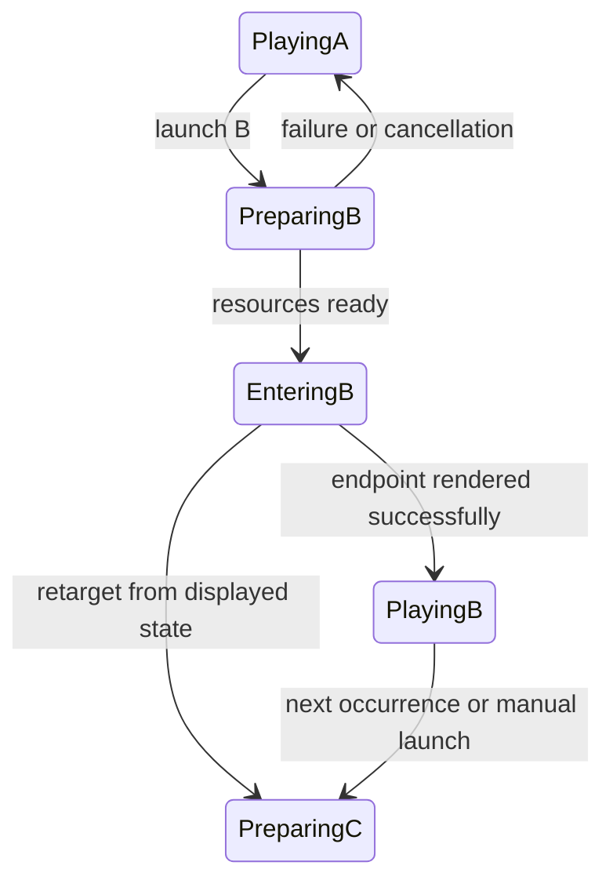

# Visual-owned Story entry — approved design, revision 2

Status: planned, not implemented. User approved the design and requested tickets and attached plans on 17 September 2026. This attachment does not authorize implementation. Extends LUX-194 after LUX-198.

## Result and scope

Jump between arbitrary beats of the same visual without replacing its instance. The visual can move a ball from its actual position onto a new path, or reshape the current solar system into another beat. Lux still owns scheduling, clocks, cancellation and resources. Different visuals retain the existing compositor prepare/overlap/dispose path. Opt-in capability preserves legacy visuals and saved scenes.

A beat declares reusable behavior; an occurrence chooses a beat, dwell and typed input overrides. A pose describes the rendered state; it is not a serialized Lux object. Authors retain their own positions, velocities and simulation state.



## Runtime contract

An ephemeral entry record contains transition identity, source activation, destination occurrence/beat/visual identity, driver (visual/compositor/cut), phase, elapsed, finite duration and progress. Preparation progress is indeterminate unless real progress is available. Do not invent a percentage. Destination local duration and dwell both start only after entry finishes and its endpoint renders. Entry time does not consume either clock.

Add optional preparation and entry hooks to the SDK, backed by explicit capability/version discovery. Conceptual hooks are `prepareBeat(request, signal)` and `beginBeatTransition(request)`; concrete types are finalized in the runtime ticket and consumed unchanged by the UI ticket. Preparation receives resolved immutable destination inputs and abort semantics. Entry receives those inputs and the latest source activation; the author captures actual current state when entry begins. `frame.story.transition` supplies identity, endpoints, elapsed, duration and normalized progress. Finite nonnegative duration is validated, with a host upper bound documented by the runtime implementation. Lux drives completion; no unbounded author completion callback.

Same-visual entry keeps one instance. Preparation must not mutate its live rendering state. Every prepare result is tied to request and visual-generation identity. Superseded asynchronous completions cannot commit. Cancelled prepared resources are released; active resources remain alive until no longer referenced. Different-visual overlap retains the existing two-slot budget. A new request replaces the pending request; it does not queue hidden destinations.

During preparation A continues. During entry, authors that declare retargeting can redirect from their currently displayed state; they may continue the current entry while new assets prepare, capturing the then-current state when ready. Without retarget support, smooth launch is disabled during entry; Cut remains available after required resources are ready. A cut cannot bypass missing assets. Return to Normal is an ordinary destination with the same preparation and transition rules.

Preparation failure leaves A running and reports an actionable destination error. Failure after author mutation cannot promise rollback: retain the last good image, stop advancement, expose recovery/retry/return-normal when the runtime is healthy; otherwise require visual restart. Never claim a running simulation was restored from an image.

## Transport semantics

| Action | During entry |
| --- | --- |
| Pause Story | Freeze entry clock; ambient animation can continue |
| Pause Preview | Freeze all animation |
| Auto-advance off | Stop scheduled advance, let active entry finish |
| Finish entry | Render destination start; begin its local clocks after success |
| Cut to beat | Prepare required assets, skip entry, render target start |
| Scrub | End entry, render requested target-local time, pause Story; only if seek supported |
| Replay | Request the active destination at local time zero using normal entry policy |

Scheduled next occurrence follows the same entry path. A sustained beat has no fabricated local timeline. Looping a seekable timed beat remains a local loop, not repeated entry; explicitly replaying requests entry. Auto-advance disabled preserves remaining dwell. Target dwell remains untouched until target playback begins. Commands validate request/generation identity so stale UI or MCP actions cannot finish a newer entry.

## Typed occurrence inputs

Support overrides of declared controls plus declared image asset slots for the concrete palette-and-record-label example. Reuse control types and asset resolution; do not accept arbitrary executable code or untyped JSON. Resolve defaults then occurrence overrides into an immutable activation snapshot. Overrides do not modify saved visual defaults. Normal playback uses the visual's ordinary controls. Existing live modulation remains evaluated separately against activation controls; triggers are events and cannot be persisted as occurrence values. Changing an override in the editor affects the next activation; explicit replay applies it now. Asset preparation precedes entry and retains resources through their final render use. Palette interpolation belongs to the author.

Persist occurrence overrides and entry policy (Visual default or Cut), not runtime transition state. Old scenes load with empty overrides and legacy behavior. Validate unknown keys, incompatible types, invalid assets and nonfinite numbers before activation. Preserve unsupported input data on read where existing compatibility rules permit; never silently execute it. Cold loads remain visibly preparing; preloading is an optimization, not a correctness prerequisite.

## UI/UX

```text
STORY                         [Return to Normal]
Orbit → Collision · Entering 42%     0.8 / 2.0 s
[============----------------]       [Pause Story] [Finish entry]
Auto-advance [on]        Collision starts after entry

Sequence  [Orbit · Leaving] → [Collision · Entering] → [Aftermath]

Selected occurrence: Collision 2
Entry   [Visual default ▾]        Stay [20 seconds ▾]
Inputs  Palette [Amber]           Label image [Choose…]
        Overrides apply on next launch. [Replay with changes]
[Launch] [Cut ▾]
```

The playback strip stays prominent while inspecting another occurrence. Preparing shows the outgoing beat playing and the destination loading, with error/retry if needed. Entering shows entry progress, not a misleading destination playhead. Playing shows the existing local scrubber for timed seekable beats or sustained status. Selection never launches. Sequence remains a ribbon rather than a globally fixed timeline because holds and preparation have variable length.

Entry defaults to Visual default; Cut is a secondary explicit action. Explain disabled smooth launch for visuals without retarget support. Explain that scrubbing ends entry and pauses Story. Keep focus stable, provide keyboard operation, announce phase/destination changes but not every frame. Narrow layouts wrap controls without hiding transport or covering the preview. No generic easing editor or named-style system in this scope.

## Integration and limits

Extend existing generic data-driven MCP commands, discovery and status; no scene-specific or per-beat tools. UI and MCP share admission rules, clocks and capabilities. Update compiler contracts, runtime compatibility, source-owned visual skill examples and install/check that skill with delivery. Resolume story export and playback speed remain out of scope. No general visual-state serialization, physics migration, arbitrary shader hot swap or unlimited preloaded slots.

Two delivery slices and their validation contracts are in [the delivery plan](visual-owned-entry-plan.md). Independent critique and dispositions are attached in [review](visual-owned-entry-review.md).

## Review resolutions — normative contract

These decisions supersede the conceptual omissions above; exported spelling can follow repository conventions without changing semantics.

- Use Story document v3 in Scene v8, and entry capability version 1. Migrate Scene7/Story2 by adding empty overrides and legacy entry behavior; reject unsupported future versions with an actionable error without overwriting the source file. Do not add opaque unknown-field preservation. Controls use existing validated scalar/enum/boolean types; images use declared slot IDs and authorized portable scene asset references, never absolute paths. The declaration lists allowed image slots and defaults.
- Same visual means the same `visualId` within the same generation. Retain its `slotId` and instance. Rebuild invalidates all prepared results and entries; resume only through existing generation admission/recovery. Normal uses the same identity rule.
- `prepareBeat(request, signal)` returns `{ durationSeconds, prepared }`, where `prepared` is an author-owned opaque handle scoped to the request, not serializable input. Preparation cannot mutate live state. Validate finite duration in `[0, 60]` seconds before calling `beginBeatTransition(request, prepared)` synchronously at a frame boundary. Missing prepare hook yields no handle and uses declared default duration, subject to the same bound. The author receives a paired release hook for every prepared handle, including cancelled/failed results, exactly once after its last use. Asset lease lifetime remains host-owned.
- Capability declares `entryVersion: 1`, `defaultDurationSeconds` and `canRetarget`. Frame transition fields are `{id, sourceActivationId, targetActivationId, targetBeatId, targetOccurrenceId, elapsedSeconds, durationSeconds, progress}`; destination IDs are nullable for Normal. Host status is a discriminated `preparing | entering | playing | failed` union, with generation/request IDs throughout. Preparing exposes source/destination and elapsed time, not fabricated progress. Failed exposes stage and admissible recovery actions.
- Zero duration renders one endpoint with progress 1 and commits only after successful presentation; do not flash a fake progress bar. Preparation elapsed uses monotonic wall time; a 30-second watchdog aborts with retryable preparation failure. Asset work can finish during either pause, but entry begins only on the next eligible presented-frame boundary. Story pause freezes source story/local/dwell and entry clocks, while ambient animation continues. Preview pause freezes every animation clock and presents no frames. Preparation itself can settle under either pause. Target local/dwell remain zero through the presented endpoint; that presentation establishes their start anchor.
- Allow one visible entry and at most one pending prepared target. While C prepares, B's current entry can continue. D cancels C; late C results are released and never committed. Ready C captures the then-displayed state at an eligible frame boundary. Runtime image leases distinguish resolved image selections and share references safely; bound them to resources still used by the visible entry plus one pending target. Cancelled/retired leases release after their final rendered use, not simply on selection change.
- All ownership-changing commands carry generation and expected request/transition identity. Acceptance receipt means requested/preparing; endpoint-applied is a separate status acknowledgment. Stale Finish/Cut/Retry cannot affect newer work. Finish ends the visible entry and cancels a pending replacement; Cut replaces pending work but still prepares required assets. Unsupported retarget rejects smooth replacement during entry with a reason, not a hidden queue.
- Failure stages are prepare, begin, update/render, and endpoint presentation. Prepare failure leaves source live. Begin failure is treated conservatively as potentially mutated unless author execution never began. Later failures freeze story clocks and retain the last presented image; status reports failure, not rollback. Retry is permitted only when the instance remains healthy and recaptures its current state; otherwise restart is required. Recovery capabilities determine Return Normal availability.
- Add explicit tests for B→C→D out-of-order completion, both pauses in both phases, zero/60/invalid durations, rebuild during preparation/entry, stale commands, first endpoint presentation failure, portable image save/reopen, all launch paths and same/different-visual Normal. Verify slot/instance identity and lease counts, not just screenshots.
